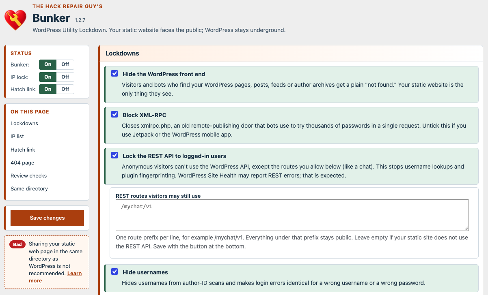

  

<h1 align="center">The Hack Repair Guy's Bunker</h1>

<strong>WordPress Utility Lockdown.</strong> Your static website faces the public; WordPress stays underground.

If your public website is static HTML (often built and updated by AI) and WordPress only sits behind it for contact forms, mailing-list sign-ups, a chat backend or a database, most of WordPress is unused, yet bots still hammer all of it. Bunker switches off the parts of WordPress that bots and hackers go after, and keeps open the few doors your static site actually uses.

It is not about pretending WordPress isn't there. It is about closing the doors that get hit.

Current release: **1.2.11**. See [release notes](releases/v1.2.11.md).

  
   
  Free. Upload the zip in WordPress, and later updates arrive on the Plugins screen.

  
    
  <a href="https://hackrepair.github.io/wp-bunker/" title="The Bunker project page">Visit the Bunker page</a>

## What it does

**Settings → Bunker** has one checkbox per lockdown. Each saves the moment you change it. Untick one and its description flips to say what just happened, and the card turns amber. Every lockdown is on by default, except the two optional ones at the end.

1. Hide the WordPress front end (visitors and bots get a plain 404)
2. Block XML-RPC
3. Lock the REST API to logged-in users, except routes you allow
4. Hide usernames (author scans, the users API, login errors that give names away)
5. Turn off comments, pingbacks and trackbacks
6. Turn off public registration
7. Turn off application passwords
8. Lock the login page and dashboard to your IP addresses (IPv4, IPv6 and ranges; Cloudflare aware)
9. Turn off the built-in code editors
10. Hide version files, logs and folder listings (`.htaccess` rules)
11. Block PHP in the uploads folder (`.htaccess` rules)
12. Watch WordPress's scheduled tasks and warn when they stall, with the cron line that fixes it
13. Optional, off by default: only allow the form actions you list for logged-out visitors
14. Optional, off by default: answer 404 to everything WordPress-related

Your forms keep working. The form endpoints stay reachable, the optional known-actions lockdown lets through only the exact action names you list, and REST routes your static site calls can be allowed by prefix. Test your forms and chat after changing these settings.

Below the options: the **hatch link**, your site's **404 page** setting, and read-only **review checks** (an `admin` account, unused plugins and themes, debug mode, an `error_log` in the web folder, and WordPress sharing a directory with your `index.html`).

## Hatch link: a spare key

The IP lock is the normal way in. If your address changes, the hatch link is a way back. Opening it emails the administrator, and nothing happens until someone presses **Approve** on the page behind that email link. Approval lets the browser that asked (not the one that clicked) through for 1, 4, 12 or 24 hours.

- Only a hash of the link is stored, and the link is shown once.
- Making a new link, or switching the hatch off, signs out every approved browser.
- At most one approval email a minute and five an hour. If the email can't be sent, the hatch stays shut.

## Nothing happens until you say so

The first time the page opens, Bunker asks *"Is that how this site works?"* and enforces nothing until you choose **Lock it down**. The IP lock has a second step: it starts only after you have reviewed and saved your list. A light column beside the settings has **On | Off** switches for Bunker itself, the IP lock and the hatch link. Switching Bunker **Off** pauses every lockdown and removes its server rules, and keeps your settings.

## Security alerts (new in 1.2.10)

Bunker blocks what bots go after. The alerts tell you when something important changes. Under **Email alerts** there are three separate opt-in checkboxes, all off by default:

- an account gains the administrator role (new account, promotion, or the role added to an existing account)
- a new plugin is installed through WordPress (upload, repository or WP-CLI)
- a new theme is installed through WordPress

Tick the ones you want and **Save changes**. Alerts go to the site administration email, or to the address you type in **Send alert emails to** (separate from the hatch approval address). Each message names the site, the time, the account or plugin/theme, and who did it when WordPress knows. Updates, reinstalls, activation and failed installs send nothing.

- They work even before you choose **Lock it down**, so you can use them on a site where you haven't turned any lockdown on. A paused Bunker, safe mode and multisite switch them off.
- If WordPress can't hand an alert to mail, Settings shows a notice. It clears after the next alert that sends, or when you save the settings. Nothing is retried.
- They watch changes made through WordPress. Files copied over SFTP or File Manager, custom privileged roles and direct database edits are outside their reach.
- They report; they don't prevent. Someone who already controls an administrator account can switch alerts off or change the recipient, so treat an alert as a prompt to look, not as protection.

## Emails

Bunker sends mail only through WordPress's own mail, with subjects like `[example.com] [Bunker] Welcome`:

- **Welcome**, once, to the administrator who first activates it.
- **Approve or deny a hatch request**, each time someone opens the hatch link from outside your IP list.
- **Scheduled tasks stalled**, optional and off by default, at most once a week.
- **Security alerts**, optional and off by default (1.2.10 and later): administrator access added, new plugin installed, new theme installed.

## Safe and recoverable

- `define( 'THRG_BUNKER_SAFE_MODE', true );` in `wp-config.php` pauses every lockdown and removes the server rules until you take the line out.
- Server rules sit between `# BEGIN THRG Bunker` and `# END THRG Bunker`. Bunker backs up the file, locks it, writes it atomically and checks your home page, login page and uploads afterward. A server error puts the old file straight back. On Nginx, Bunker shows the rules to copy instead.
- If a check is inconclusive, Bunker keeps the backup and shows a short notice with a button to set it aside once you've checked your site. Nothing is shown otherwise.
- **Deactivating** switches everything off: rules removed, hatch link killed, Bunker left paused. Settings are deleted only when you delete the plugin with **Delete all plugin data** ticked.
- Renaming the plugin folder stops PHP enforcement; server rules stay until removed through your hosting File Manager.
- Multisite is not supported yet; Bunker enforces nothing there.

## Privacy and scope

Bunker makes no outside requests except update checks against this repository's GitHub releases. Security alert emails (1.2.10 and later) include the affected account or plugin/theme and the person who made the change. Its health checks request only your own home page, login page and a temporary uploads file. Settings, hashed hatch material and short-lived approval state stay in your WordPress database. A hatch request records the requesting IP address and browser, which appear in the approval email.

Bunker is not a firewall, malware scanner, login-attempt limiter or two-factor plugin, and it does not log visitors. Configure certificates, HTTPS redirects and HSTS through your hosting provider.

## Install

Upload the plugin ZIP under **Plugins → Add New → Upload Plugin**, or place the `thrg-bunker` folder in `wp-content/plugins/`, then activate it and open **Settings → Bunker**.

Requires WordPress 6.9.4 or newer and PHP 7.4 or newer. The plugin lives in the `thrg-bunker` folder and starts from `index.php`. Updates come from this repository's [GitHub releases](https://github.com/hackrepair/wp-bunker/releases "All Bunker releases and download files").

## Author and support

**[Jim Walker](https://hackrepair.com/)** — The Hack Repair Guy — author and maintainer.

[Questions, ideas and community support](https://github.com/hackrepair/wp-bunker/discussions) · [Report a bug](https://github.com/hackrepair/wp-bunker/issues) · [Security reporting](SECURITY.md) · [Buy Jim a coffee](https://hackrepair.com/donations/buy-jim-a-coffee)

## License and credits

[GPLv2 or later](LICENSE "GNU General Public License, version 2").

Update checks use [Plugin Update Checker](https://github.com/YahnisElsts/plugin-update-checker "Plugin Update Checker on GitHub") 5.7 by Jānis Elsts (MIT license), included unmodified.

Made by [The Hack Repair Guy](https://hackrepair.com/ "The Hack Repair Guy: WordPress security and hack repair").

## Changelog

See the **Changelog** section of [`readme.txt`](readme.txt).
